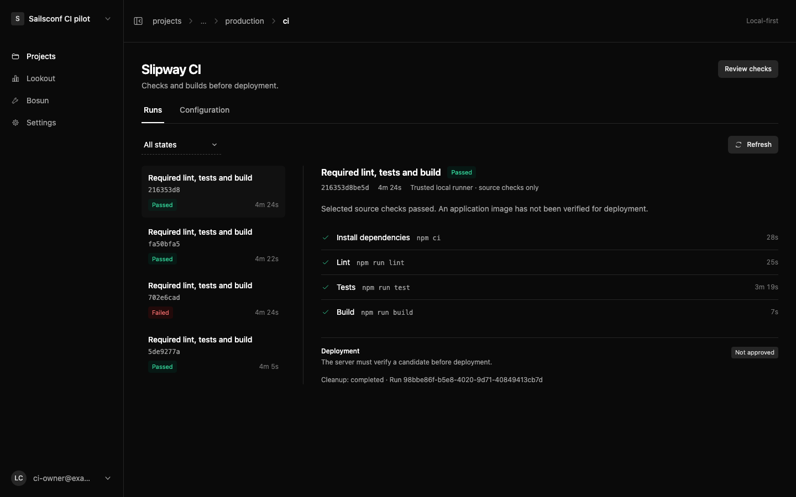
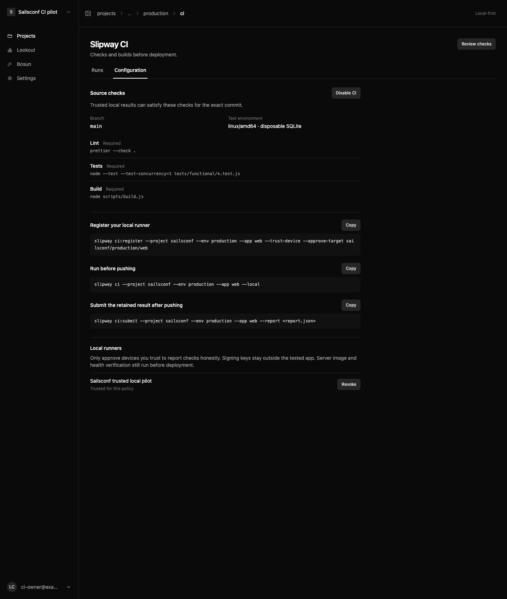

# Slipway 0.0.120: introducing Slipway CI

You already ran lint, tests and the build on your laptop. Why send the same commit off to another machine to start over?

Meet **Slipway CI**.

Run your checks locally in a disposable container. Push the commit. Submit the result. Slipway verifies the signed evidence from your approved device, then builds and checks the deployment candidate on your server before moving traffic.

It starts with the scripts your Sails app already has: `lint`, `test` and `build`. No workflow YAML for this supported flow. No production credentials inside the check container. One place to see source checks and deployment verification, with the distinction kept visible.

We tested it with Sailsconf: lint, **330 tests passed**, one skipped, and a successful build. That was a real local pilot; production rollout follows installation and explicit owner approval.

You choose which devices to trust. Change the runtime or commands, and the policy needs review again. Revoke a device, and its previous results cannot admit a deployment.

This first version supports npm, pinned Node 22 and disposable SQLite through Docker Desktop. Keep existing GitHub checks while you validate it for your app. We have not measured a like-for-like GitHub speedup, and a device signature is not proof against a dishonest device administrator.

Your checks, your machine, your deployment server. Connected through Slipway.

[Read the CI guide](https://docs.sailscasts.com/slipway/ci) · [Slipway 0.0.120](https://github.com/sailscastshq/slipway/releases/tag/v0.0.120)

---

Publication notes (remove before posting): verify the server image build and smoke checks succeeded, CLI 0.0.4 is published, and the docs PR is live. Attach the two original PNGs rather than sharing private local paths. This is a draft, not a published announcement. Do not say Sailsconf production CI is enabled until owner approval and a real server deployment complete.
